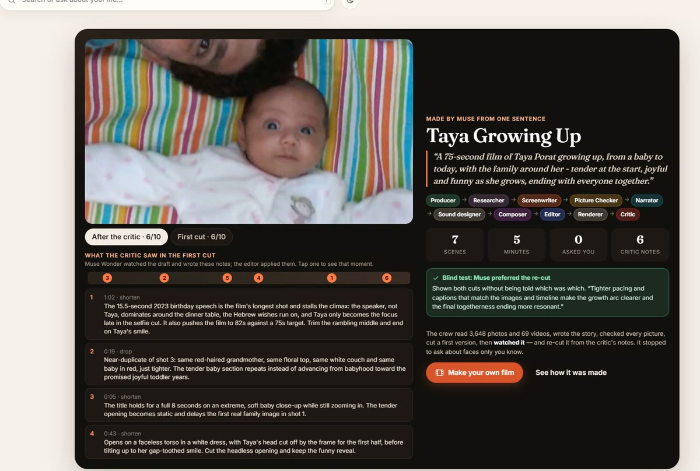
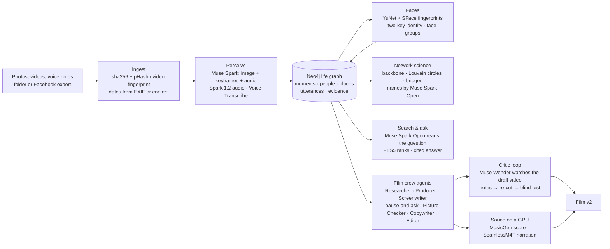

# Muse Life Graph

**Twenty thousand family photos nobody looks at → a reasoned life graph → a personal film, written, cut,
watched and re-cut by a crew of Meta Muse agents from one sentence.**



| | |
|---|---|
| **Live demo** | https://agmonporat--muse-life-graph-web.us-east.modal.run — one real family's library, shared with consent. The access code is in the submission form (Project Description). Judges can browse, search, ask questions and make a film; names are read-only. |
| **Run it on your photos** | [Download for Windows](https://github.com/agmonp/muse-life-graph/releases/latest/download/MuseLifeGraph-windows.zip) (your own Meta key, a free graph database; see [below](#run-it-on-your-own-computer)) |
| **Video (3 min)** | https://youtu.be/JX4o7B06awk |
| **Measurements** | [docs/EVALS.md](docs/EVALS.md) |
| **Built for** | Meta Global AI Developer Hackathon (Cerebral Valley), Oct 26 – Nov 4, 2026 |

## Built during the hackathon

Everything in this repository was written from an empty folder starting **2026-10-26** (the first commit,
`bff5b70`, is the scaffold; `git log --reverse` shows every step). No code was copied from earlier projects.

The demo library is the author's own family photos. Their names, one reference face per person and the
family groups were imported **as data only** from the author's earlier, private "Life Graph" database
(`scripts/seed_from_lifegraph.py` reads it read-only); that earlier app is not part of this project or the
demo. All perception, graph building, face fingerprints, circles, search and films shown were produced by
this code during the hackathon.

## What it does

1. **Understands a library, not just tags it.** Each photo, video and voice note gets one Muse Spark call
   (pictures, video keyframes and the soundtrack together) that returns a strict-schema perception: what
   happened, who is likely there, what was said, and *when* — with a reason when the file has no date
   ("faded color print, flared jeans and old car models point to the mid-1970s, much older than the 2009 upload"). Copies are found by perceptual fingerprint
   (WhatsApp and Facebook re-encodes count as copies), not by bytes.
2. **Names people with two keys.** Faces are fingerprinted locally (YuNet + SFace). A name goes on a face
   only when two independent keys agree; unknown faces are grouped so one answer on the "Who is this?"
   screen names many.
3. **Reasons over the graph.** Neo4j holds moments, people, places, utterances and evidence on every edge.
   Network science (disparity-filter backbone, Louvain circles, betweenness bridges) shows the circles of a
   life forming and fading year by year; Muse Spark Open names them.
4. **Makes a film with an agent crew.** One sentence → Researcher → Producer (Muse Spark) → Screenwriter
   (Muse Wonder) → *pause and ask the owner what only they know* → Picture Checker (looks at every picture)
   → **Copywriter** (rewrites the narration as one host voice: nostalgic, playful or documentary; code sends
   back any line that is too long or names something the pictures don't show) → Editor → Sound (MusicGen score, SeamlessM4T narration) → **Critic watches the rendered draft video**
   and gives timestamped notes → Editor re-cuts → **blind test**: Wonder is shown both cuts without being
   told which is the revision.
5. **Search and ask in any language**, answered only from the moments found, with citations.



## Meta AI in this project

| Meta model / tool | What it does here |
|---|---|
| **Muse Spark 1.3** (Meta Model API) | Perception of every photo, video (keyframes + soundtrack) and voice note in strict JSON; Producer; Picture Checker fallback; narration judge in the evals |
| **Muse Spark Open** `meta-models/muse-spark-open-1026` on **Baseten** (open weights) | Reads every search question (people, years, search words in any language), writes the cited answers, titles all 473 memories, names the circles of people, and runs the Picture Checker on film scenes. The app shows "served by Muse Spark Open on Baseten" where it did the work |
| **Muse Spark 1.2** | Listens to blessings recorded through a link and picks the film-worthy lines with an English subtitle |
| **Muse Wonder 1.0** | Screenwriter; Copywriter (the narration as one host voice); Critic that watches the rendered draft *video*; the blind v1-vs-v2 judge |
| **Muse Voice Transcribe 1.0** | Hebrew and English speech in videos and blessings, with speaker turns and timestamps |
| **SAM 3.1**, **Muse Image 1.0** | Adapters (`mlg/muse/sam.py`, `mlg/muse/image.py`) and the day-1 capability probe ([docs/probe_report.md](docs/probe_report.md)); Muse Image made the fictional test family used until 2026-10-27. Neither is in the live pipeline now: faces come from Muse Spark boxes + YuNet |
| **MusicGen medium** (Meta open weights) | An original score per film, on the owner's GPU or a Modal A10G |
| **SeamlessM4T v2** (Meta open weights) | The narrator (5.1% word error rate vs 16.5% for MMS-TTS, `scripts/voice_eval.py`) |

### Runs on Meta open weights

`mlg/muse/chat.py` has one switch: `chat.ask(..., task="search")` runs on **Muse Spark Open** through
Baseten's OpenAI-compatible API when `BASETEN_API_KEY` is set and the task is listed in `MLG_SPARK_OPEN`
(default `search,titles,circles,checker`; `all` or `none` also work). Spark Open reasons first, so every
call gets at least 4,000 output tokens; if it fails or takes longer than 60 s (picture calls sometimes take
minutes on Baseten), the call falls back to the Muse Spark API and the answer says so. Every call is logged with its provider and task in `data/cache/usage.jsonl`.

What runs on it: search understanding and answers (`mlg/search.py`), memory titles (`mlg/library.py`),
circle names (`mlg/network.py`) and the Picture Checker (`mlg/studio/checker.py`, with images). Measured
against the Muse Spark API on the same 30 inputs in [docs/EVALS.md §6](docs/EVALS.md). Subtitle translation
stays on the API: in the test, Spark Open added the speaker's name to a line.

MusicGen and SeamlessM4T are Meta open weights too, run on the owner's own GPU (`.venv-gpu`,
`mlg/studio/gpu_worker.py`) through an outgoing bridge, with one Modal A10G as the fallback when the PC is off.

## Measurements (real data, [docs/EVALS.md](docs/EVALS.md))

| What | Result |
|---|---|
| Who is in the photo: face fingerprints alone vs the earlier graph's answers (3,508 photos, 7,091 person-photo pairs) | 80% precision at 37% recall (similarity ≥ 0.50 with a 0.10 margin); the app's two-key links: 93% / 60% |
| Face groups: share of a group's faces that are its main person (known faces); random open groups checked by eye | 97% (upper bound); 4 of 12 one person, 7 mixed, 1 unsure |
| Blind test, first cut vs critic's re-cut, all 8 finished films, both orders | **re-cut won 12 of 16 viewings** (5 films both times, 1 film lost both, 2 split) |
| Copywriter's host-voice lines vs the screenwriter's, 8 films, blind (Muse Spark judges, both orders) | **rewritten lines preferred in 16 of 16 viewings**; no unsupported facts flagged in either set ([details](docs/evals/copywriter.md)) |
| Narration vs picture (separate Muse Spark judge, 35 lines) | 40% match, 51% partly, 9% no; measuring it found a Picture Checker bug, fixed |
| Time and cost per film (median, hosted demo) | 7.2 min, $3.04 of Muse calls (mostly the Screenwriter reading the whole library) |
| Muse Spark Open vs Muse Spark API, 30 inputs | Picture Checker: same keep/drop on 33 of 35 pictures; search: same people/years on 10 of 15; same cost; image calls slower (median 15 s vs 6 s) |

## Privacy

Muse Life Graph is made to run where your photos are: **on your own computer**. It reads a folder or your
Facebook / Instagram download in place; the files never leave your machine except as the model calls
themselves (Meta's API or Baseten, never a `-contributor` model that trains on your data). The graph can be a
local Neo4j. Reference faces stay in a git-ignored folder. The live demo is one family's library, shared by
its owner with consent, behind an access code; visitors cannot rename anyone.

## Run it on your own computer

**Windows 10/11: download the app.** Get
[MuseLifeGraph-windows.zip](https://github.com/agmonp/muse-life-graph/releases/latest/download/MuseLifeGraph-windows.zip)
from the latest [release](https://github.com/agmonp/muse-life-graph/releases), unzip it and open `MuseLifeGraph.exe`.
The first screen asks for two things of your own and tests them before saving:

- a **Meta Model API key** ([dev.meta.ai](https://dev.meta.ai)); you pay Meta directly, about $0.006 a photo, and the
  app shows the estimate before it spends anything;
- a free **Neo4j AuraDB Free** database ([console.neo4j.io](https://console.neo4j.io)): the address and password from
  its credentials file;
- optionally a **Baseten** key, to run search, titles and the Picture Checker on Muse Spark Open.

Keys are saved only in `%LOCALAPPDATA%\MuseLifeGraph\settings.env`, caches and films beside them; photos are read
where they are. The app is not code-signed yet, so Windows may show "Windows protected your PC": choose *More info*,
then *Run anyway*. The zip is built in the cloud by [.github/workflows/release.yml](.github/workflows/release.yml)
from the tagged commit; `packaging/build.ps1` runs the app's self-test and `scripts/check_bundle.py`, which refuses a
build that contains any key, database, cache or media file. Music and narration need an NVIDIA GPU and are not in
the download; without them films get on-screen captions.

**From source (Windows, macOS, Linux):**

```powershell
git clone https://github.com/agmonp/muse-life-graph; cd muse-life-graph
py -3.13 -m venv .venv
.\.venv\Scripts\python.exe -m pip install -r requirements.txt
Copy-Item .env.example .env        # MODEL_API_KEY (Meta), BASETEN_API_KEY (optional), NEO4J_*
.\.venv\Scripts\python.exe -m mlg.graph.db                                  # create the graph schema
.\.venv\Scripts\python.exe -m uvicorn mlg.web.app:app --port 8800          # open http://localhost:8800
```

Then **Add photos**: a folder, or the .zip files from Meta's *Download your information*. The app
fingerprints every file (copies are set aside), shows the cost before Muse looks (about $0.006 a photo),
and builds your memories, people, circles and films. Music and narration need a GPU (`.venv-gpu` with
torch, see `mlg/studio/gpu_worker.py`); without one, films get on-screen captions.

```powershell
.\.venv\Scripts\python.exe -m pytest -q tests                          # offline checks
.\.venv\Scripts\python.exe -m mlg.studio.make "A 60-second film of Taya growing up" --template birthday
.\.venv\Scripts\python.exe scripts\eval_spark_open.py                   # Spark Open vs API
.\.venv\Scripts\python.exe scripts\evals.py                             # -> docs/EVALS.md
```

Hosting the demo: `deploy/modal_app.py` (Modal; `MLG_DEPLOY_GPU=1` adds the A10G fallback).

## Code map

| Path | What it is |
|---|---|
| `mlg/muse/` | Meta Model API + Baseten client: chat with image/audio/video parts, strict JSON, provider switch, cache, usage log; Voice Transcribe; SAM 3.1 and Muse Image adapters |
| `mlg/ingest/` | Hashing, perceptual duplicates, dates, Facebook export reader |
| `mlg/perceive/` | The perception pass, its schema, code-enforced evidence rules, face-only second check |
| `mlg/graph/` | Neo4j schema and idempotent writes |
| `mlg/faces.py`, `mlg/identity.py` | Face fingerprints, groups, two-key linking, the owner's answers |
| `mlg/library.py`, `mlg/network.py`, `mlg/search.py` | Memories, timeline, people network and circles, search and ask |
| `mlg/studio/` | The film crew: research, plan, ask, checker, edit, render, sound, subtitles, critic, make |
| `mlg/shema/` | Blessings recorded through a link |
| `mlg/web/` | The app (FastAPI + one-page UI) |
| `scripts/` | Evals, seeding from the earlier graph, site bundle, GPU bridge |
| `docs/` | [PRD](docs/PRD.md), [evals](docs/EVALS.md), [probe findings](docs/PROBE_FINDINGS.md), [demo video materials](docs/video/) |

Development used Claude Code as a coding assistant. License: Apache-2.0.
